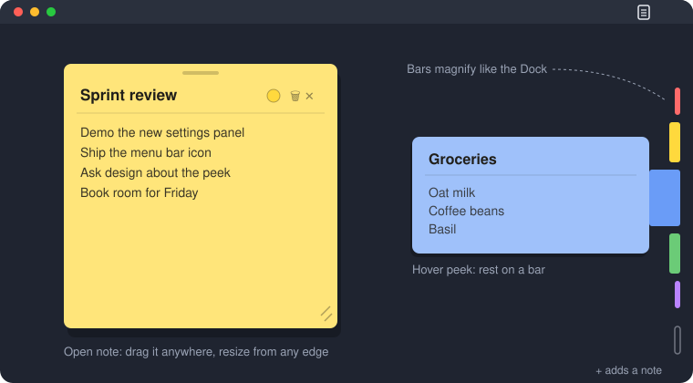

# Snap Notes

**Your notes, one glance away — and never in the way.**

Snap Notes turns sticky notes into slim colored bars along the edge of your screen. Hover to make them grow like the macOS Dock, rest on one to peek inside, click to unfold a full note. Everywhere else, your clicks go straight to the apps behind it.

<p align="center">
  
</p>

## Why you'll love it

- **Always there, never in the way.** About 6 px per note, always on top. Turn on auto-hide and the strip disappears completely until you touch the screen edge.
- **Capture in a second.** Cmd/Ctrl+Shift+Space creates a note from any app. Drop a file on the strip, or make a note straight from your clipboard.
- **Peek before you open.** Rest on a bar to read the note without leaving what you're doing.
- **Never miss a thing.** Write `@15:00` or `@friday` in a title, or pick a date in the calendar. When it's due you get a notification and the note's bar jumps to get your attention. One click puts it in your calendar or mail, note text included.
- **Notes that look good.** Real formatting: bold, italic, headings, checklists, links, images, colors and highlights. Checklist bars fill up as you tick items off.
- **Stay organized.** Color-code notes, pin important ones to the top, drag bars onto each other to stack related notes, and search everything as you type.
- **Your screen, your way.** Dock the strip to the right, left or top edge. It adapts to light and dark mode on its own, and every look and motion detail is adjustable.
- **Your data stays yours.** No account, no cloud, no installer needed. One executable; your notes are plain JSON files in your own app-data folder. Export everything to Markdown or text whenever you like.

## Works everywhere

macOS, Windows and Linux, from a single small executable.

## Get it

Download the latest build for **Windows, macOS (Apple silicon) or Linux** from [Releases](https://github.com/FabianRiegsinger/snap-notes/releases):

- **macOS:** open `snap-notes-macos-arm64.dmg` and drag Snap Notes into Applications. The app is not notarized, so the first time, right-click it and choose Open. If macOS says it is damaged, run `xattr -dr com.apple.quarantine "/Applications/Snap Notes.app"`.
- **Windows:** run `snap-notes-windows-x64-setup.exe`. It installs for your user only (no admin needed) and adds Snap Notes to the Start menu. Remove it under Settings > Apps.
- **Linux (Debian/Ubuntu):** `sudo apt install ./snap-notes-linux-x64.deb` (or `-arm64`). Snap Notes then shows up in your app menu.

The plain executables are still there if you'd rather not install anything. Or build it yourself:

```bash
cargo build --release
./target/release/snap-notes
```

Linux builds need `pkg-config`, `libxkbcommon-dev`, `libwayland-dev` and `libfontconfig1-dev`.

## Shortcuts worth knowing

| Shortcut | Does |
|---|---|
| Cmd/Ctrl+Shift+Space | New note, from any app |
| Ctrl+Shift+1…9 | Open note 1–9, counted from the top, from any app |
| Cmd/Ctrl+N | New note |
| Cmd/Ctrl+F | Search |
| Cmd/Ctrl+, | Settings |
| Esc | Close the front note or panel |

## Learn more

Every feature, the formatting and reminder syntax, all settings and where your data lives are covered in the **[full guide](docs/GUIDE.md)**.

Built in Rust with [iced](https://iced.rs). MIT licensed.
